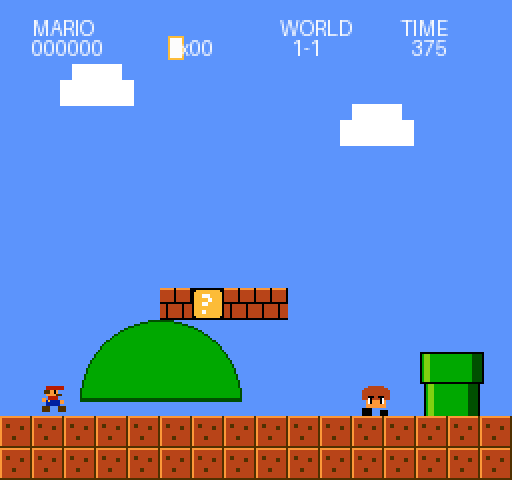

# Super Mario Bros - Retro Pixel Web Game

A lightweight, self-contained retro pixel platformer inspired by Super Mario Bros. Built entirely with vanilla HTML5, Canvas, and Web Audio API—zero external dependencies, zero build steps.

  

## Features

- **Procedural 8-bit Pixel Art**: Handcrafted NES-style sprites for Mario (idle, running animations, jump), Goombas, animated `?` blocks, brick blocks, pipes, and flagpole.
- **Physics Engine**: Smooth platformer mechanics with horizontal momentum, variable jump heights, and B-dash sprinting.
- **Classic Gameplay**:
  - Break bricks and bump `?` blocks to collect coins.
  - Stomp Goombas to defeat them.
  - HUD tracking score, coin count, world stage (1-1), time remaining, and lives.
  - Finish line flagpole and castle sequence.
- **Synthesized 8-Bit Audio**: Nostalgic chiptune sound effects (jump, coin chime, stomp, bump, level clear fanfare, game over) powered by Web Audio API.
- **Responsive & Touch Friendly**: Seamless play on desktop and mobile browsers with on-screen virtual controls.

## Controls

| Action | Keyboard | Touch Controls |
|---|---|---|
| **Move Left / Right** | `←` / `→` or `A` / `D` | Left / Right D-Pad |
| **Jump** | `Space` / `↑` / `W` | `A` Button |
| **Sprint / Dash** | `Shift` | `B` Button |
| **Mute / Unmute** | `M` | — |
| **Start / Restart** | `Space` or `Enter` | Screen Tap |

## Quick Start

Open `index.html` directly in any web browser:
- Double-click `index.html` or `start-game.bat` on Windows.
- Or host directly on GitHub Pages!

## GitHub Pages Deployment

1. Push this repository to GitHub.
2. In your repository, go to **Settings** > **Pages**.
3. Under **Build and deployment**, select `Deploy from a branch` and set Branch to `main` / `root`.
4. Click **Save**. Your game will be live at `https://<your-username>.github.io/<repo-name>/`!

## License

MIT License.
